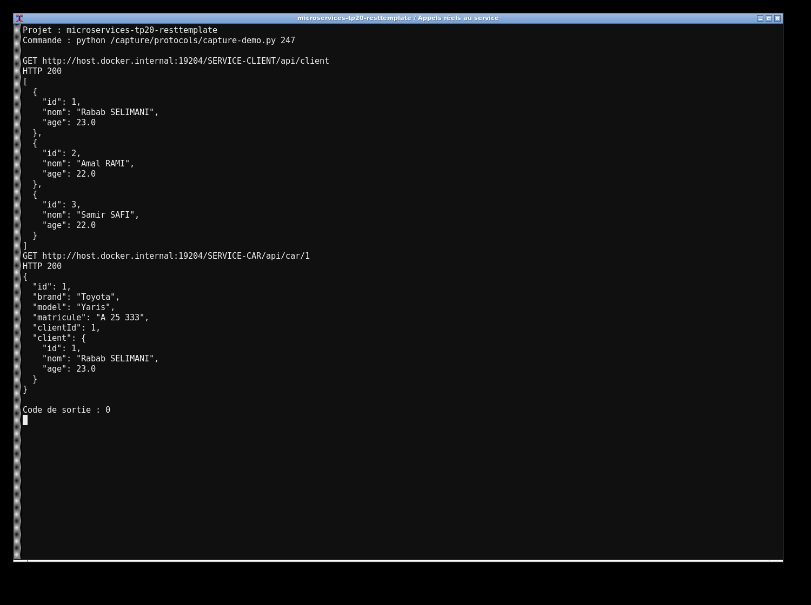
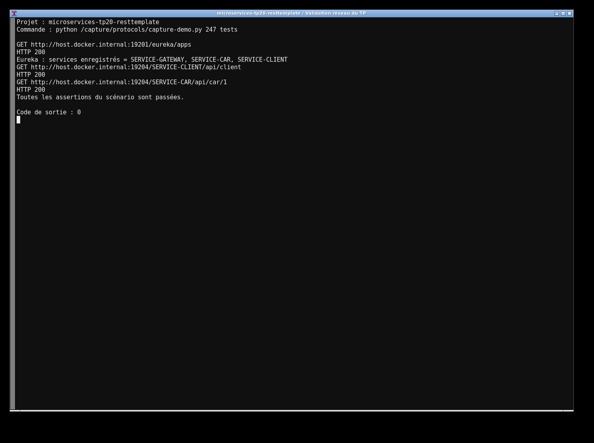

# TP20 — Microservices avec RestTemplate

L’application contient Eureka, une Gateway et deux services métier. Client et Car utilisent des bases MySQL distinctes. Le service voiture appelle l’API Client via la Gateway avec RestTemplate, puis enrichit la réponse JSON. Les délais de connexion et lecture sont limités à cinq secondes.

```bash
mvn clean verify
# MySQL : voir compose.yml, puis lancer chaque jar dans son terminal
java -jar eureka-server/target/eureka-server-1.0.0.jar
java -jar service-client/target/service-client-1.0.0.jar
java -jar gateway/target/gateway-1.0.0.jar
java -jar service-car/target/service-car-1.0.0.jar
```

Les ports sont 8761, 8081, 8888 et 8082. Tester `/SERVICE-CLIENT/api/client` et `/SERVICE-CAR/api/car` sur la Gateway. La configuration est en YAML et les paramètres MySQL peuvent être remplacés par DB_URL, DB_USER et DB_PASSWORD.

Si Client est indisponible, les informations de la voiture restent disponibles avec `client:null`. Les tests utilisent H2 ; les vérifications réseau enregistrées ont aussi été faites avec MySQL. Boot 3.2 et Cloud 2023 sont alignés, car le Cloud 2021 cité dans l’exemple ne fonctionne pas avec Jakarta.



